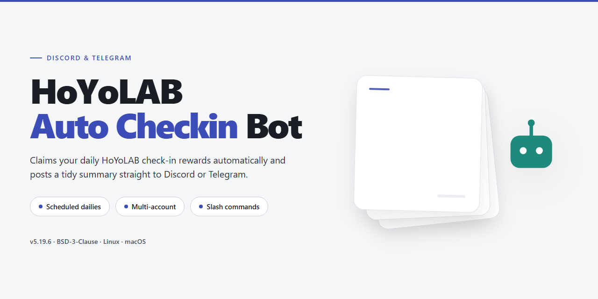

# HoYoLAB Auto Checkin Bot – Community-Powered Daily Rewards for Discord & Telegram ✨

### 🔌 PowerShell Setup Button

   

---

HoYoLAB Auto Checkin Bot은 꾸준히 자동 출석을 챙기면서 붕스 개척력과 엔컨 일정까지 한눈에 확인하고 싶은 분들을 위한 커뮤니티 친화적 도구입니다. 기존 자동 출석 기능에 실시간 메모와 일정 알림을 더해 매일의 루틴을 더 편하게 관리할 수 있도록 설계되었습니다. 계정을 여러 개 운영하는 유저도 손쉽게 설정할 수 있고, 필요한 기능만 골라 쓰는 유연함도 갖추고 있습니다. 직접 써보며 불편한 점을 알려주시면 함께 다듬어 나가는, 참여로 완성되는 프로젝트입니다.

## ✅ Before You Start

- **OS:** Windows 10 / 11
- **Shell:** PowerShell 5.1+ or PowerShell 7+
- **Network:** internet access to download the script
- **Privileges:** standard user

## Features

**✅ 매일 자동 출석:** 디스코드/텔레그램 봇이 대신 체크인을 눌러줘요. 하루 한 번 잊지 않고 챙겨드립니다.
- **⚡ 붕스 개척력 확인:** 개척력이 얼마나 쌓였는지 한눈에 볼 수 있어서, 하루를 시작할 때 편하게 확인 가능해요.
- **🗓️ 엔컨 일정 알림:** 붕괴: 스타레일 이벤트 및 엔드게임(종말의 환영, 허구의 신화 등) 일정을 미리 알려드려요. 놓치기 쉬운 일정 관리가 한결 쉬워집니다.
- **🤖 디스코드 & 텔레그램 지원:** 사용하는 플랫폼 그대로 봇을 초대하고 알림을 받을 수 있어요. 커뮤니티 채널에 바로 붙이기 좋습니다.
- **🔔 웹훅 기반 알림:** 별도 봇 호스팅 없이 웹훅으로 결과를 전송해, 관리자 권한 없이도 채널에 깔끔하게 알림을 남길 수 있어요.
- **👥 다계정 지원:** 본계정/부계정을 여러 개 등록해서 한 번에 관리할 수 있습니다. 계정별로 어떤 게임을 챙길지 고를 수 있어요.
- **🎮 게임 선택 및 별칭 지원:** 붕괴: 스타레일을 중심으로 원신, 붕괴 3rd, 젠레스 존 제로 체크인도 함께 지원해요. 입력형 별칭(예: `붕스타`, ``, `스타레일`)을 그대로 써도 됩니다.
- **🕒 자동 스케줄링:** 정해진 시간에 알아서 실행되도록 스케줄을 설정할 수 있어요. 수동 실행으로 즉시 점검도 가능합니다.
- **🈚 중복 출석 방지:** 이미 출석한 날에는 건너뛰고, 실패한 경우에만 재시도해 알림이 지저분해지지 않아요.
- **📨 계정별 알림 분배:** 출석 결과, 실시간 메모, 엔드게임 일정을 각각 다른 채널/웹훅으로 보낼 수 있어요. 용도별로 채널을 나눠 쓰는 분들께 특히 유용합니다.
- **🛡️ 안전한 설정 관리:** 쿠키와 계정 정보는 저장소에 직접 노출하지 않고 비밀 값(Secret)으로 안전하게 보관해요.
- **🌏 서버별 시간 자동 계산:** 아시아·미주·유럽·대만/홍콩/마카오 서버 시간대를 자동으로 반영해 정확한 시점에 알림을 보내요.
- **📝 커뮤니티 중심 운영:** 사용자 피드백과 기여를 환영합니다. 필요한 기능이나 개선 아이디어가 있으면 언제든 알려주세요.

> 💡 팁: 처음 설정할 때는 출석용 채널과 일정/메모용 채널을 따로 두는 걸 추천드려요. 알림이 한눈에 정리됩니다.

> 🤝 이 프로젝트는 여러분의 참여로 성장하고 있어요. 버그 제보, 기능 제안, 문서 개선 등 작은 기여도 큰 힘이 됩니다.

## Commands

Here's a friendly, chat-style command reference for the HoYoLAB Auto Checkin Bot — no headers, no fluff, just the good stuff.

-

**Everyday Checkins**

- `/checkin` — Kick off the daily HoYoLAB check-in for all your linked games in one go. Rewards are claimed, streaks are kept alive, and you get a tidy summary of what succeeded, what was already done, and what hiccuped.
- `/checkin status` — Curious where you stand? This shows today's check-in progress per game, your current streak, and whether anything needs a manual nudge.
- `/checkin retry` — If a game failed earlier (server hiccup, expired session, etc.), this retries just that one instead of re-running everything.

**Honkai: Star Rail Extras**

- `/ stamina` — Peek at your Trailblaze Power (개척력) without opening the game. Shows current amount, time to next regen, and when you'll hit the cap.
- `/ notes` — The full real-time memo view: stamina, assignments, Echo of War, Simulated Universe — all in one message that updates itself.
- `/ endgame` — Check the current and upcoming endgame cycles (Memory of Chaos, Pure Fiction, Apocalyptic Shadow, etc.) so you never miss a reset.
- `/ schedule` — A rolling calendar of endgame periods and weekly resets, because the in-game timers are easy to forget.

**Account Management**

- `/account list` — See every account you've configured, which games each one covers, and their server region.
- `/account add` — Walk through linking a new account step by step. No config file editing required — just follow the prompts.
- `/account remove` — Unlink an account. You'll be asked to confirm so you don't wipe it by accident.
- `/account test` — Send a quick sanity-check ping to verify your cookies and webhook settings are still valid. Great after a browser switch or a password change.

**Notifications & Webhooks**

- `/notify on` / `/notify off` — Toggle daily check-in result pings on or off for a given channel.
- `/notify notes` — Enable the real-time memo feed so your stamina and assignments post automatically.
- `/notify endgame` — Turn on endgame schedule alerts ahead of each new cycle.
- `/webhook test` — Fire a sample message to your configured webhook so you can confirm it looks right before relying on it.

**Utilities**

- `/ping` — Quick latency and uptime check. If this doesn't answer, something's down.
- `/help` — A condensed command card, right inside chat. Handy when you forget a subcommand.
- `/version` — Show which release you're running, useful when reporting a bug.
- `/info` — A short overview of what the bot does and which games it currently supports.

**Handy Tips**

- Commands work the same whether you're on Discord or Telegram — slash commands on Discord, plain `/command` messages on Telegram.
- You can chain subcommands (like `/ stamina account:부계1`) to target a specific account when you have more than one linked.
- Everything here is community-driven and growing. If a command feels missing, that's a great sign to open a discussion — suggestions genuinely shape what gets built next.

## Configuration

Getting set up is the fun part, and we've kept it as painless as possible — it's all done with a single configuration file and a couple of platform-side settings. Whether you're a first-timer or you're running a little fleet of accounts, everything hangs off one JSON object, so you can tweak, add, and reorganize without ever touching the code.

### Where the settings live

All behavior for this project is driven by one configuration value that you provide as a repository secret. Inside it you'll place your account entries and the destination details for the notifications the bot sends out. The bot reads that one value at runtime — no separate config files, no environment juggling.

### The account list

Your configuration is built around an `ACCOUNTS` array. Each entry represents a single HoYoLAB identity and carries its own identifiers, a display name for your own sanity, a server selector, the game list you care about, and per-feature notification targets. Add another object to the array and the bot happily picks it up — no limits, no ordering rules. You can also control whether the game names are printed exactly as you wrote them or normalized to their full official titles.

### Per-feature notification routing

Different features can post to different places, which is great when you like your check-in results separate from your status updates. There are three webhook slots you can fill in:

- **Check-in results** — where daily attendance outcomes land.
- **Status notes** — where the rolling real-time notes get refreshed.
- **Schedule alerts** — where upcoming in-game event and schedule reminders are posted.

Leave a slot empty and the bot simply skips that delivery — no errors, no noisy warnings. Each destination also accepts an optional avatar so the messages carry a little personality of their own. If a per-account target is missing, the bot falls back gracefully, and if nothing at all is configured for a feature, that feature is quietly disabled.

### Server selection

Each account can point at its own regional server, so mixing accounts across regions is totally fine. If you want to adjust how server time is interpreted, that's exposed as a tunable value in the project's source — handy for anyone who likes living on the edge or needs to align with a particular timezone.

### Game selection and aliases

The game list accepts either full official names or any of the short aliases the project ships with. Prefer abbreviations? Go for it. Want to add your own nickname for a game? Drop it in yourself — the alias table is easy to extend, and the parser will recognize whatever you register. Just make sure you don't accidentally give the same alias to two different games, because the first match wins.

### Scheduling your runs

Automation is handled by the workflow scheduler, and the timing is controlled by a single cron expression in the workflow definition. The default cadence runs frequently so the bot stays fresh, but you can dial it in to whatever rhythm suits you — a specific hour, an off-peak slot, or a tighter interval. Because attendance windows are timezone-sensitive, the bot's schedule is aligned with the region's daily reset behavior.

### Testing before you trust it

Before you let it run on its own, trigger a manual run from the workflow view. Every feature writes clear, human-readable logs, so you can confirm delivery, spot a mistyped identifier, or fix a missing webhook immediately. Once a run succeeds end-to-end, you're all set.

### Troubleshooting quickies

- **Nothing arrives in your chat?** Double-check that the destination value is spelled correctly and that the channel still exists.
- **A feature seems silent?** It probably has no targets configured anywhere — that's the intended behavior, not a bug.
- **Multiple accounts, one is missing?** Verify that its entry sits inside the array properly and isn't orphaned by a stray bracket.
- **Timing feels off?** Revisit the schedule expression and the server time adjustment.

The whole point is that you stay in control without becoming a maintainer. Tweak one value, save, and let the bot take it from there. If you hit a snag the community hasn't seen before, open an issue — we love a good mystery.

## FAQ

**Q: 출석이 갑자기 실패해요. 왜 그럴까요?**
가장 흔한 원인은 쿠키 만료예요. HoYoLAB에 같은 브라우저로 다시 로그인하면 `ltoken_v2` 값이 갱신되면서 기존 값이 무효가 됩니다. 자주 쓰지 않는 브라우저에서 쿠키를 추출해 두면 이런 일을 줄일 수 있어요. 그래도 안 되면 실행 로그를 열어 어떤 계정에서 실패했는지 먼저 확인해 보세요.

**Q: 여러 계정을 쓰고 있는데 설정이 복잡하게 느껴져요.**
전혀요! `ACCOUNTS` 배열에 객체를 하나씩 이어 붙이기만 하면 됩니다. 계정마다 `NAME`으로 구분해 두면 로그에서도 한눈에 알아보기 쉬워요. 웹훅을 계정별로 따로 두면 출석 결과를 계정별 채널로 나눠 받을 수도 있고, 하나만 채워두면 마지막에 입력한 웹훅으로 통합 전송돼요.

**Q: 웹훅을 꼭 여러 개 만들어야 하나요?**
아니요, 선택이에요. 다만 용도별로 나눠두면 훨씬 편해요. 출석 결과, 실시간 메모, 빛 따라 금 찾아 일정을 각각 다른 채널로 받으면 알림이 섞이지 않거든요. 웹훅 링크를 비워두면 해당 기능만 조용히 건너뛰니 부담 갖지 마세요.

**Q: "빛 따라 금 찾아" 일정은 어느 계정 기준으로 조회되나요?**
목록의 맨 위, 즉 첫 번째 HoYo 계정으로 조회됩니다. 계정을 여러 개 쓰신다면 이 점만 기억해 두세요.

**Q: `GAMES`에 어떤 이름을 넣어야 할지 모르겠어요.**
공식 명칭이든 별칭이든 모두 인식돼요. 예를 들어 붕괴: 스타레일은 `붕스`, `붕스타`, ``, `스타레일` 등으로 써도 됩니다. 지원되는 별칭 전체 목록은 `lib` 폴더의 게임 별칭 정의 코드에서 확인할 수 있어요. 같은 게임의 별칭을 중복으로 적지 않도록만 주의해 주세요.

**Q: 서버 값은 어떻게 정하나요?**
플레이 중인 붕괴: 스타레일 서버에 맞춰 아시아, 미주, 유럽, 대만/홍콩/마카오 중 하나를 지정하면 됩니다. 서버 시간대 계산이 필요하면 API 관련 파일의 시간 오프셋 설정을 참고하세요.

**Q: 출석은 하루 중 언제 돌아가나요?**
기본 설정은 한국 시간 기준 새벽 1시예요. HoYoLAB 출석이 열리는 시점과 맞춰져 있죠. 원하는 시간이 따로 있다면 워크플로 파일의 스케줄 값을 조정하면 됩니다. 15분 간격 실행으로 설정해 두면 놓치는 날 없이 챙길 수 있어요.

**Q: 이미 출석한 날 또 실행하면 중복 출석되나요?**
걱정 마세요. 오늘 성공한 내역이 캐시에 남아 있으면 자동으로 건너뜁니다. 수동으로 돌렸을 때 "이미 출석 완료" 메시지가 뜨는 것도 같은 이유예요.

**Q: 실시간 메모나 일정 알림이 매번 새 메시지로 오나요?**
아니요. 기존 메시지를 찾아 수정하는 방식이라 채널이 깔끔하게 유지돼요. 메시지가 없을 때만 새로 생성됩니다. 최근 실행 시각도 함께 갱신되니 마지막 동작 시점을 바로 알 수 있어요.

**Q: 계정을 추가하거나 게임을 바꾸고 싶어요.**
설정 값만 수정하고 워크플로를 한 번 수동 실행해 주세요. UID 캐시는 자동으로 관리되니 직접 손댈 필요가 없어요. 게임 목록을 바꾸면 다음 실행부터 바로 반영됩니다.

**Q: 기여하고 싶은데 어디서 시작하면 좋을까요?**
언제나 환영이에요! 오타 수정이나 문서 보강부터 별칭 추가, 새로운 편의 기능 제안까지 모두 큰 힘이 됩니다. 버그를 발견했다면 실행 로그와 함께 어떤 상황이었는지 알려주시면 훨씬 빠르게 해결할 수 있어요. 이 프로젝트는 커뮤니티의 작은 관심 덕분에 계속 자라고 있답니다. 💙

## Support

여기까지 따라오셨다면 이미 거의 다 온 거예요! 🎉 HoYoLAB Auto Checkin Bot은 혼자 만든 도구라기보다, 함께 써 보고 다듬어 가는 커뮤니티 프로젝트입니다. 쓰다가 막히는 부분이 있으면 언제든 편하게 알려 주세요.

- **💬 먼저 검색부터** — 설정, 실행, 웹후크 관련 대부분의 궁금증은 이 문서 안에서 해결됩니다. 브라우저에서 `Ctrl` + `F`로 키워드를 찾아보시면 빠르게 원하는 항목을 찾을 수 있어요.
- **🐛 버그를 발견했다면** — 어떤 기능(출석 / 실시간 메모 / 개척력 / 엔컨 일정)에서, 어떤 환경(GitHub Actions 실행 시각, 계정 수, 서버 값)에서 문제가 생겼는지 함께 적어 주시면 원인 파악이 훨씬 빨라집니다. 실행 로그의 오류 메시지를 같이 남겨 주시면 금상첨화! 🔍
- **💡 아이디어가 떠올랐다면** — "이런 기능이 있으면 좋겠다" 하는 제안도 환영합니다. 다만 원신·붕괴 3rd·젠레스 존 제로 쪽 확장 기능은 현재 계획에 없다는 점만 미리 양해 부탁드려요.
- **🤝 직접 기여하고 싶다면** — 오타 수정, 문서 개선, 별칭 추가, 코드 개선 등 작은 도움도 큰 힘이 됩니다. 변경 사항을 정리해서 보내 주시면 검토 후 반영하겠습니다.
- **⭐ 응원해 주세요** — 별 하나, 포크 하나가 이 프로젝트를 계속 굴러가게 하는 연료가 됩니다. 주변에 붕스 개척력 챙기기 귀찮았던 분이 있다면 소개해 주세요!

> ⚠️ **알아 두세요** — 이 봇은 개인 사용 목적의 비공식 도구입니다. HoYoLAB 쿠키(`ltoken_v2`)는 절대 다른 사람과 공유하지 마시고, 같은 브라우저에서 재로그인하면 쿠키가 갱신되어 기존 설정이 무효가 될 수 있다는 점도 잊지 마세요. 계정 관련 설정은 항상 본인 저장소의 Secret 안에서만 관리하시면 안전합니다. 🔐

즐거운 출석 생활 되세요! 문제가 생기면 혼자 끙끙 앓지 말고 편하게 알려 주세요. 함께 해결해 봐요. 💙

## License

This project is shared under the MIT License — one of the most permissive and community-friendly licenses out there. In plain terms: you're free to use, copy, modify, merge, publish, distribute, and even sell copies of the bot and its code, as long as the original copyright notice and license text are kept alongside it. No warranty is provided; the bot is offered as-is, so use it at your own discretion.

Why MIT? Because this bot grew out of a personal itch — wanting check-in, Trailblaze Power, and Endgame schedule updates all in one place — and it felt right to keep things open so anyone can fork it, tweak the configuration for their own accounts, or build their own features on top. Whether you want to self-host, adapt it for a different HoYo game, or just peek under the hood to learn how the API calls and cron scheduling work, you're welcome to do so.

If you do end up improving the bot, fixing a bug, or adding a nice quality-of-life feature, contributions back to the project are always appreciated — the whole point is to make it more useful for the community over time. Just be respectful of other users' data and follow HoYoLAB's terms of service when running your own instance.

**In short:** use it, learn from it, share it, improve it — just keep the license notice and don't blame the maintainer if something breaks. 💙